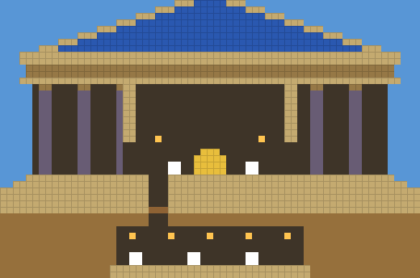
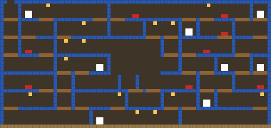

# terraria-olmypia

Ancient Greece for **Terraria** (tModLoader 1.4.4): the **Temple of Olympus** on the surface, the **Labyrinth of the Minotaur** underground, three bosses (the Minotaur, Medusa, Zeus),
a Greek bestiary, relics, potions and marble. The Terraria sibling of [minecraft-olympia](https://github.com/SolutionsAsService/minecraft-olympia) and of
[terraria-khemet](https://github.com/SolutionsAsService/terraria-khemet), built on the SHADW stack's `terraria-tmodloader` adapter ([shadw-modding](https://github.com/SolutionsAsService/shadw-modding)).

| The Temple of Olympus | The Labyrinth of the Minotaur |
|---|---|
|  |  |

These are the blueprints the world generator places, drawn by the same code (not screenshots of the game).

## What is in it (v0.1.0)

| | |
|---|---|
| **Temple of Olympus** (surface) | A 65-wide marble temple on three steps: a colonnade (the columns are background walls, so you walk through), a meander frieze, a pediment, a walled cella with an altar, braziers and two chests, and a hatch down to a crypt with three more. Placed after the vanilla Pyramids pass on the flattest, greenest ground it can find. |
| **Labyrinth of the Minotaur** (underground) | A 15 by 7 cell maze of black marble (a perfect maze, so every cell is reachable) with platforms in the floor holes so it can be climbed, torches, spike pits, eight chests in dead ends, the Minotaur's lair (3 by 3 cells) at the centre, and a roped shaft from the surface. |
| **Bosses** | **The Minotaur** (pre-Hardmode, ground boss: walks and jumps after you, charges, leaps and slams out debris, calls snakes), **Medusa** (Hardmode, hovers: dashes, spits venom volleys, calls snakes), **Zeus** (post-Plantera, hovers: dashes, fans of lightning, rains lightning in waves, calls birds). Each enrages below half life; each has a summon item, treasure bag, drops, a boss-bar icon and a "downed" flag. |
| **Enemies** | Hoplite, Satyr, Cyclops, Stymphalian Bird, Gorgon Snake, spawning on the surface, in forests, underground and (most thickly) inside the two structures. |
| **Items** | Bronze Xiphos, Labrys, Bow of Artemis, Trident of Poseidon, Thunderbolt of Zeus; Aegis, Winged Sandals, Laurel Wreath, Gorgon's Eye, Cloak of Olympus; Ambrosia, Nectar of the Gods, Wine of Dionysus (each gives a buff); the three summons; Bronze Bar, Gorgon Scale, Lightning Fragment, Ambrosia Flower. |
| **Blocks** | Olympian Marble, Black Marble, Meander Brick, Bronze Plate, all craftable. |

Previews: [items](preview/items.png), [tiles and projectiles](preview/tiles-and-projectiles.png), [enemies](preview/enemies.png), [bosses](preview/bosses.png), [buffs](preview/buffs.png).

## How it is made

Content is data (`content/*.json`); the vendored SHADW generator (`tools/shadwtmod/`) writes the whole tModLoader mod folder `Olympia/` (C#, sprites, language file, structure blueprints, build files).

```sh
python3 tools/shadwtmod/tmod.py . gen | lint | check | preview
```

## Install

1. Install tModLoader (1.4.4) from Steam.
2. Copy `Olympia/` into `Documents/My Games/Terraria/tModLoader/ModSources/`, then Workshop > Develop Mods > Build + Reload.
3. Make a **new world** (the temple and labyrinth come from world generation).

## Status, stated plainly

* **Not yet built against, or loaded in, a real tModLoader** (this machine has no route to it; steamcmd could not reach Steam). The C# compiles only against a stub of the API, which cannot prove the real API accepts it.
  `.github/workflows/build.yml` has an experimental real-build job. Expect a few API fixes on the first real build.
* Nothing has been played: boss balance, attack patterns, spawn rates and the structures' feel are untested. The maze is a perfect maze and the temple is flood-filled from its entrance in `lint`, so every room is reachable on paper.
* Sprites are generated pixel art, a first pass. No armour, trophies, music, custom walls or worm bosses yet. Wall names for the structures (`GrayBrick`, `SandstoneBrick`) are safe vanilla choices, not marble walls.

See [DESIGN.md](DESIGN.md).
